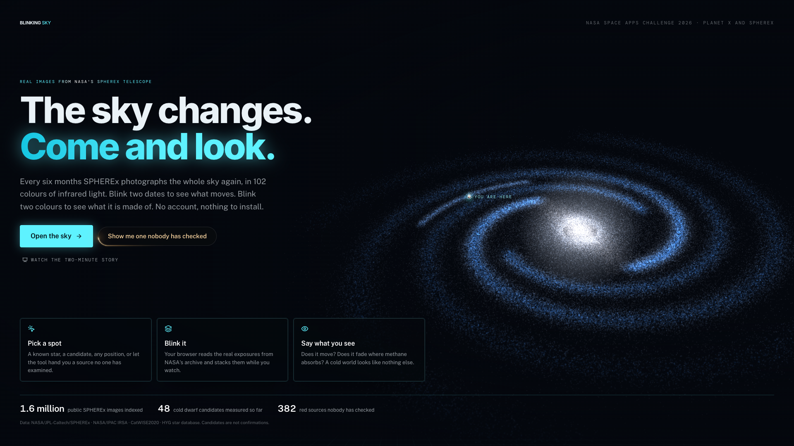
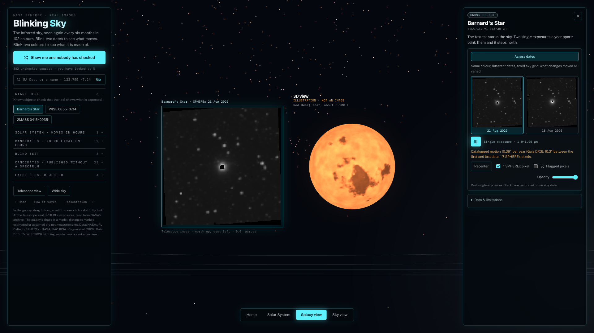
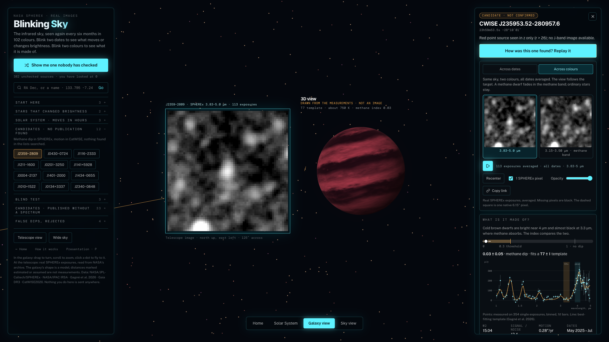
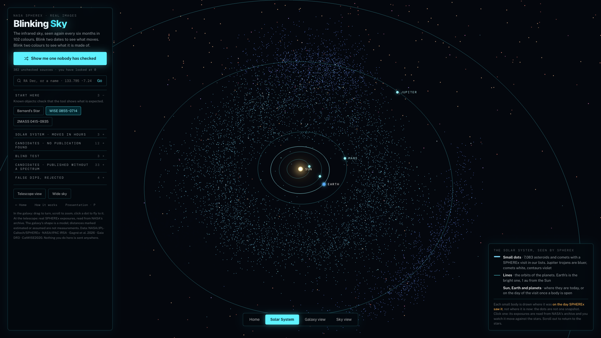
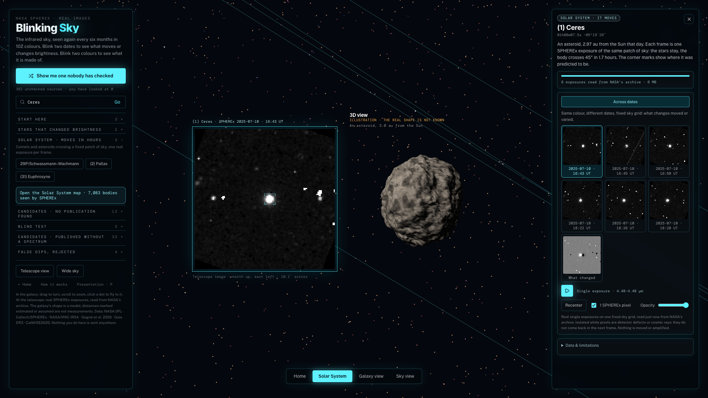
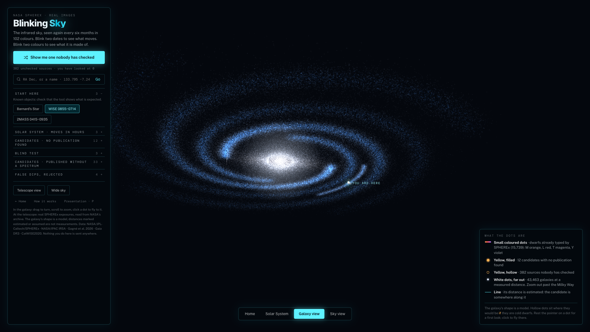
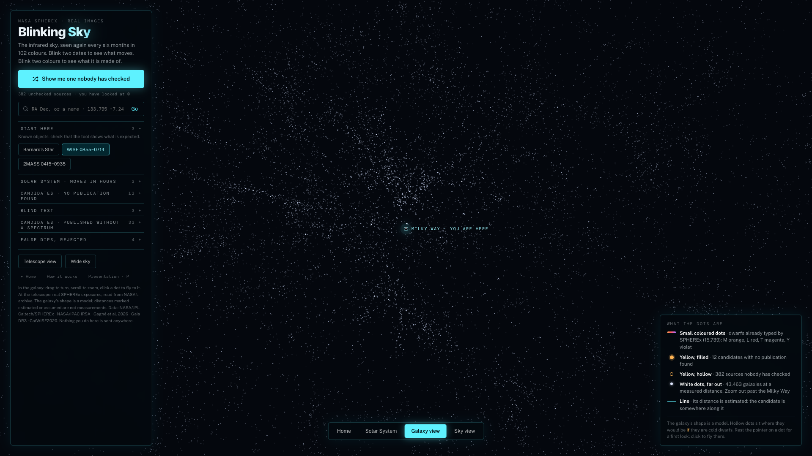
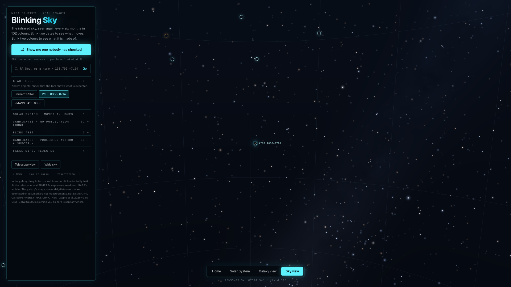
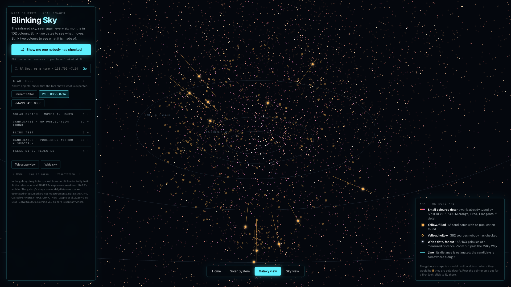

# Blinking Sky

Outil web public pour regarder les images du télescope SPHEREx de la NASA et voir ce qui change : entre deux dates (ce qui bouge) et entre deux couleurs (de quoi c'est fait). Projet du NASA Space Apps Challenge 2026, défi « Planet X and SPHEREx ».

L'interface est en anglais. Ce README et le journal sont en français.

En ligne : https://blinking-sky.vercel.app

## Captures

| | |
|---|---|
|  Page d'accueil |  Une galaxie ouverte : NGC 4639 |
|  L'étoile de Barnard, entre deux dates |  WISE 0855−0714, naine brune qui se déplace |
|  Une candidate dans la bande du méthane |  La file de sources à vérifier |
|  Le Système solaire vu par SPHEREx |  Cérès, poses lues en direct |
|  La Voie lactée, avec la position du Soleil |  Les 43 463 galaxies autour de la Voie lactée |
|  La vue du ciel |  La carte des naines proches |

## Ce que fait l'outil

- **Un ciel** : les 58 719 étoiles brillantes du catalogue HYG, une grille, et un cercle par champ SPHEREx préparé.
- **Deux clignotements** : par date (grille fixe sur le ciel) et par couleur (bande du méthane contre 3,8–5 µm).
- **Des images réelles** : moyennes de vraies expositions SPHEREx. Rien n'est animé ni amplifié, les pixels manquants restent noirs.
- **En direct** : pour une source de la file ou une position quelconque, le navigateur trouve les expositions qui couvrent la position, lit une petite fenêtre de chacune dans le bucket public de la NASA et les empile sous les yeux de l'utilisateur (environ 170 expositions, 50 Mo, une minute).
- **Un vote** : « Fades in methane », « Stays the same », « Two sources », « Artefact », « Nothing there ». Les votes restent dans le navigateur.
- **Une fiche candidate** imprimable, et une vue 3D de l'objet dessinée d'après ses mesures (étiquetée comme illustration).
- **Une page d'accueil** : la Voie lactée vue de l'extérieur (modèle schématique repris de Project Atlas : barre, quatre bras, éperon d'Orion), avec la position du Soleil. « Open the sky » plonge vers le Soleil et ouvre le ciel.
- **Une présentation** intégrée (touche P).

## Lancer

```bash
cd app
npm install
npm run dev
```

Node 22 ou plus récent. Aucun compte ni clé. `npm run build` produit un site statique dans `app/dist`.

## Vocabulaire et limites

Les sources listées sont des **candidates**. Le type vient d'une photométrie SPHEREx empilée à basse résolution, pas d'un spectre classique. « No publication found » veut dire absente des catalogues et listes interrogés, pas inconnue. La mesure faite dans le navigateur est une estimation rapide ; l'analyse par ajustement de PSF reste la référence. Détails dans l'interface (« Data & limitations ») et dans `app/public/data/cold-dwarfs.json`.

## Contenu du dépôt

| Chemin | Rôle |
|---|---|
| `app/` | L'application (Vite, React, three.js) |
| `app/src/spherex/` | Lecture des images SPHEREx par plages d'octets, WCS, empilement, photométrie rapide, index |
| `app/src/reactbits/` | Composants d'interface animés repris de React Bits (reactbits.dev), sous leur propre licence |
| `app/validate.mjs` | Comparaison du lecteur JavaScript avec les mesures de référence |
| `app/public/index/` | Index des 1,6 million d'images publiques (DR1 et QR3), en tuiles |
| `app/public/data/` | Champs préparés, file de revue, étoiles, images profondes |
| `build_*.py`, `stack_images.py` | Scripts qui ont préparé les données (ils lisent des dossiers de recherche locaux) |
| `JOURNAL.md` | Ce qui existait avant le hackathon et ce qui a été fait pendant |

## Crédits

SPHEREx : NASA/JPL-Caltech/SPHEREx, via NASA/IPAC IRSA. Positions et mouvements : CatWISE2020. Gabarits spectraux : Gagné et al. 2026. Étoiles : HYG Database v4.4 (CC BY-SA 4.0). Images profondes : Legacy Surveys DR10 et unWISE. Interface : three.js (ciel et vue 3D en WebGL), React Bits (textes et cartes animés), Lucide (icônes).
