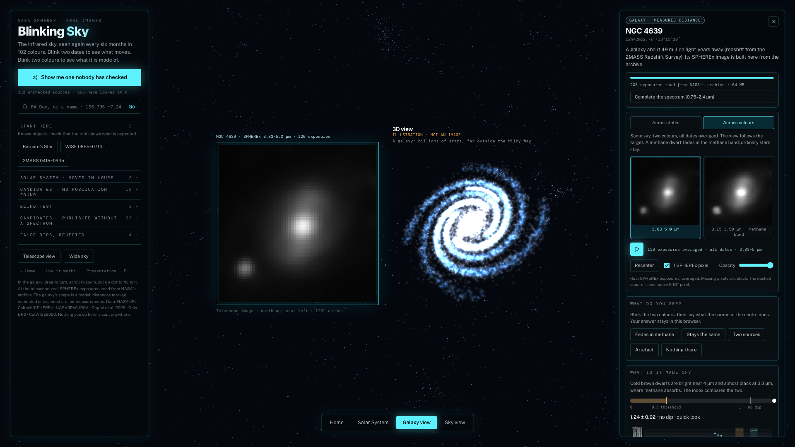
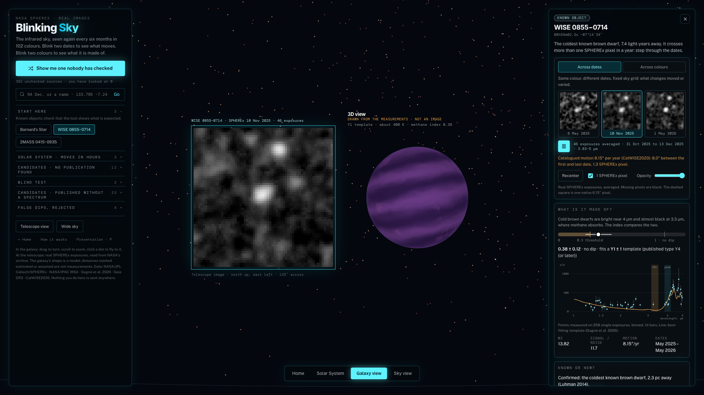
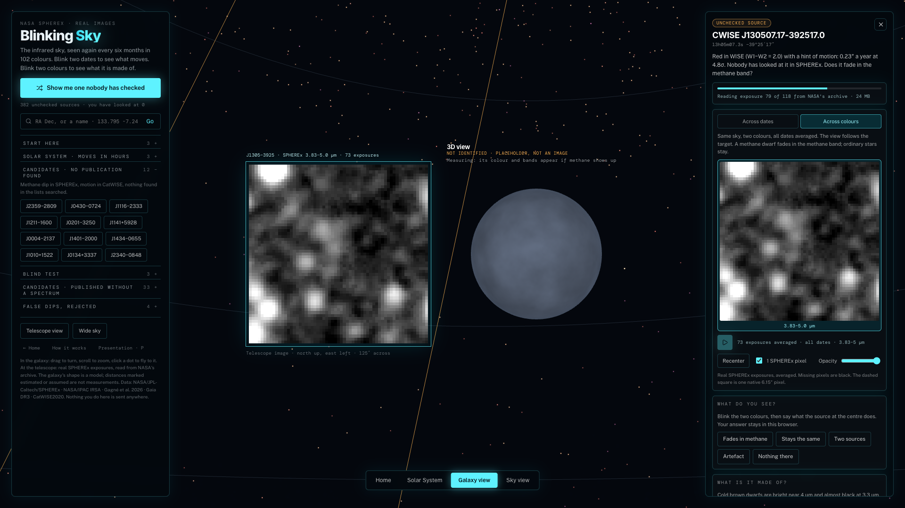
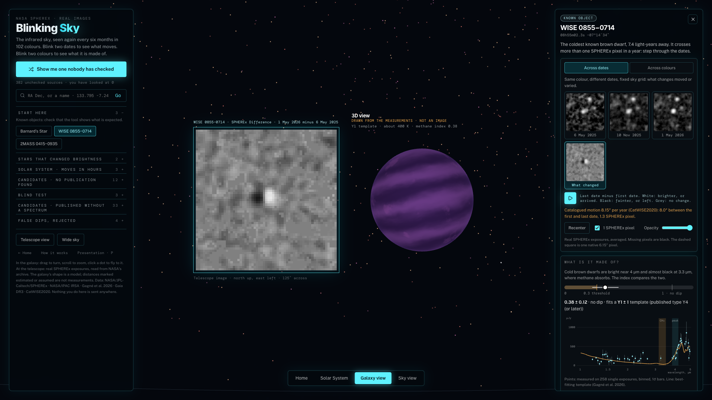
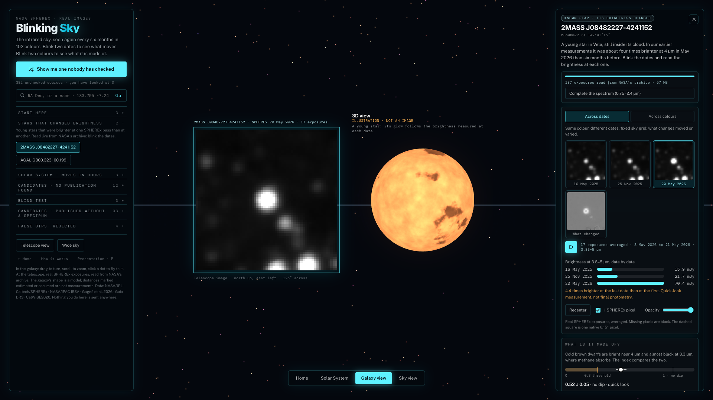
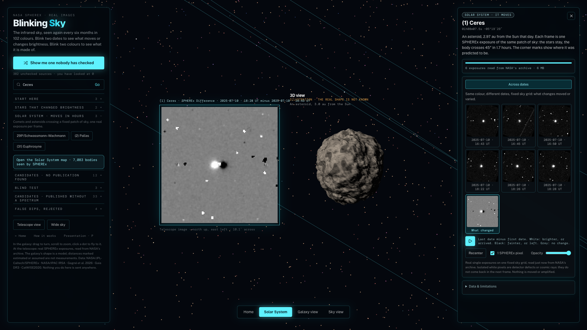

# Blinking Sky


A public web tool to look at real images from NASA's SPHEREx telescope and see what changes: between two dates (what moves, what changes brightness) and between two colours (what it is made of). A project of the NASA Space Apps Challenge 2026, challenge “Planet X and SPHEREx”, by team Apollo XXI.

**Try it: https://blinking-sky.vercel.app** · Demo video: `submission/video/blinking-sky-demo-30s.mp4`

## Before and during the 48 hours

Not everything here was made during the event. In plain terms:

**Prepared before the event** (by one team member, in the days before 14 November 2026):

- The search for cold brown dwarfs: the methane index, its controls, the measurements per image, the template fits and the literature check that give the candidates below.
- The index of the 1.6 million public SPHEREx images.
- The lists of SPHEREx exposures for Solar System bodies, and a pilot study of variable sources, from which the two “stars that changed brightness” come.
- A schematic model of the Milky Way and a first SPHEREx view of Barnard's Star, from an earlier personal project, Project Atlas.

**Made during the 48 hours:**

- The web tool itself: everything in `app/`.
- The in-browser reader of SPHEREx images, checked against the earlier measurements.
- The blink across dates and colours, the difference image, the brightness at each date.
- The maps (Solar System, Milky Way, galaxies), the review queue, the illustrations, the guided introduction.
- The demo video, the screenshots, the logo and the texts.

`JOURNAL.md` (in French) is the day-by-day record and keeps the two apart.

## The twelve candidates


Real SPHEREx images at 4 µm and in the methane band. These are candidates: none is confirmed by a spectrum, and some may already be known to other teams. The table is in `zenodo/blinking-sky-candidates.csv`.

## Screenshots

| | |
|---|---|
|  Home page |  A galaxy opened from the map: NGC 4639 |
|  Barnard's Star, between two dates |  WISE 0855−0714, a brown dwarf that moves |
|  A candidate in the methane band |  The queue of sources to review |
|  The Solar System as SPHEREx saw it |  Ceres, exposures read live |
|  The Milky Way, with the Sun's position |  43,463 galaxies around the Milky Way |
|  The sky view |  The map of nearby dwarfs |
|  What changed: last date minus first |  A young star, 4.4 times brighter in a year |
|  Ceres in 1.7 hours: where it was (black), where it is (white) | |

## What the tool does

- **Blink across dates.** The exposures of a position are grouped by SPHEREx pass, about six months apart, on one fixed sky grid. What moves is nearby.
- **What changed.** A difference image, last date minus first: black where an object was, white where it is now.
- **Brightness at each date.** For fields read live, the source is measured at every pass. Two young stars are 4.4 and 2.3 times brighter after one year.
- **Blink across colours.** The same position at 3.83–5.0 µm and in the methane band at 3.15–3.50 µm. A cold brown dwarf is bright in the first and almost gone in the second.
- **Real images.** Averages of real SPHEREx exposures. Nothing is animated or amplified; missing pixels stay black.
- **Read live.** For any position, the browser finds the exposures that cover it, reads a small window of each from NASA's public bucket and stacks them while you watch (about 170 exposures, 50 MB, one minute).
- **One map, three scales.** The Solar System (Sun, Earth, planets, 7,083 asteroids and comets where SPHEREx saw them), the Milky Way (15,739 dwarfs typed by SPHEREx, the candidates, 382 unchecked sources) and 43,463 galaxies at their redshift distance.
- **A review queue.** 382 red, moving WISE sources nobody has examined in SPHEREx. You look, you vote, you see the measurement. Votes stay in your browser.
- **A printable candidate sheet**, and a 3D view of each object, labelled as an illustration.

## Run it

```bash
cd app
npm install
npm run dev
```

Node 22 or newer. No account, no key. `npm run build` makes a static site in `app/dist`.

## Words and limits

The sources listed are **candidates**. The type comes from stacked, low-resolution SPHEREx photometry, not from a classical spectrum. “No publication found” means absent from the catalogues and lists searched, not unknown. The measurements made in the browser (methane index, brightness at each date, difference image) are quick looks; the PSF-fit analysis remains the reference. The 3D bodies are illustrations: the shape of an asteroid is invented. Details in the interface (“Data & limitations”) and in `app/public/data/cold-dwarfs.json`.

## What is in the repository

| Path | Role |
|---|---|
| `app/` | The application (Vite, React, three.js) |
| `app/src/spherex/` | Reading SPHEREx images by byte ranges, WCS, stacking, quick photometry, index |
| `app/src/reactbits/` | Animated interface components taken from React Bits (reactbits.dev), under their own licence |
| `app/validate.mjs` | Comparison of the JavaScript reader with the reference measurements |
| `app/public/index/` | Index of the 1.6 million public images (DR1 and QR3), in tiles |
| `app/public/data/` | Prepared fields, review queue, stars, galaxies, Solar System bodies, deep images |
| `build_*.py`, `stack_images.py` | Scripts that prepared the data (they read local research folders, given as arguments) |
| `zenodo/` | Draft article and the table of candidates |
| `submission/` | Texts of the project page, screenshots, logo, poster, demo video and its source |
| `JOURNAL.md` | What existed before the event and what was done during it (in French) |

## Credits

SPHEREx: NASA/JPL-Caltech/SPHEREx, through NASA/IPAC IRSA. Positions and motions: CatWISE2020. Spectral templates and the table of SPHEREx ultracool dwarfs: Gagné et al. 2026. Galaxies: 2MASS Redshift Survey (Huchra et al. 2012). Small bodies: IRSA Moving Object Search Tool and JPL Horizons. Stars: HYG Database v4.4 (CC BY-SA 4.0). Deep images: Legacy Surveys DR10 and unWISE. Interface: three.js, React, React Bits, Motion, Lucide. Music of the demo video: “Floating Cities” by Kevin MacLeod (incompetech.com), CC BY 4.0. The blink is the method of the citizen-science project Backyard Worlds: Planet 9.
