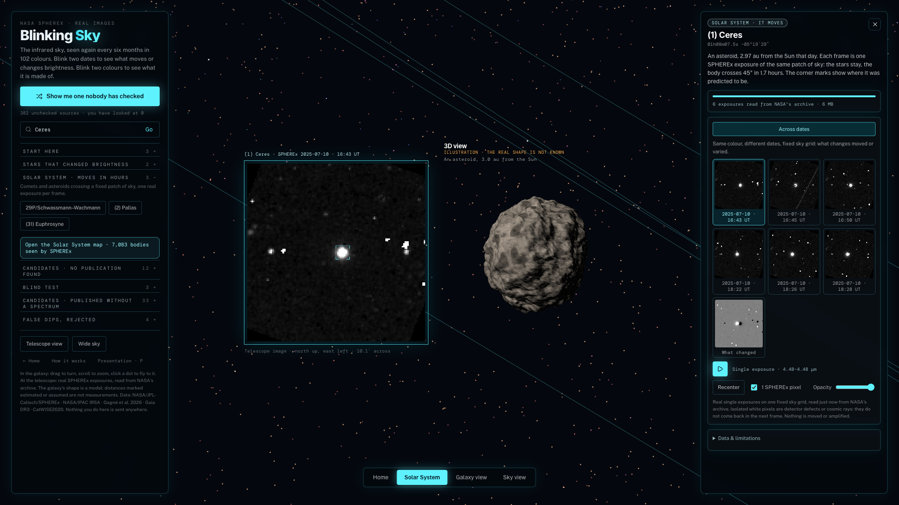
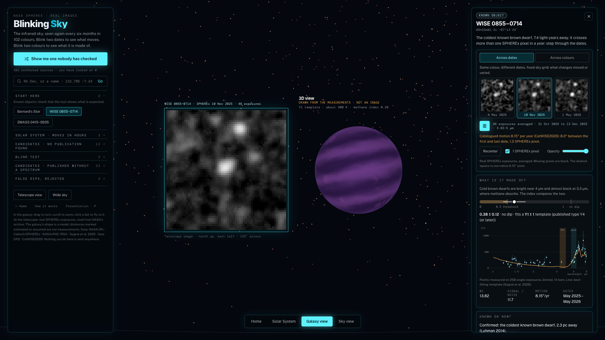
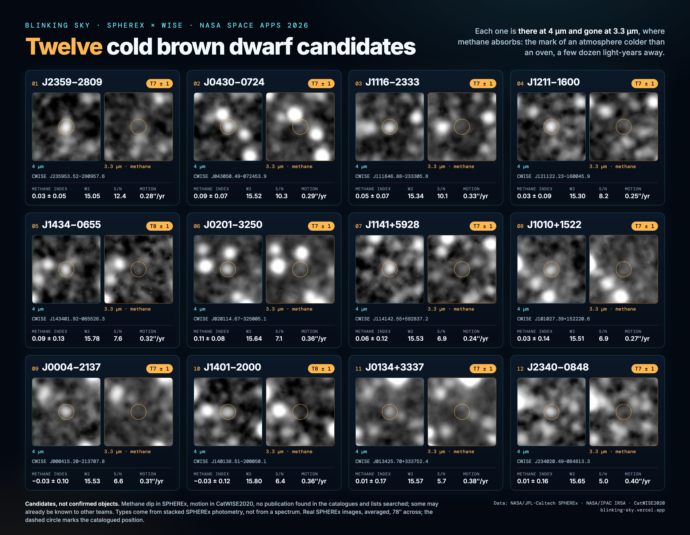
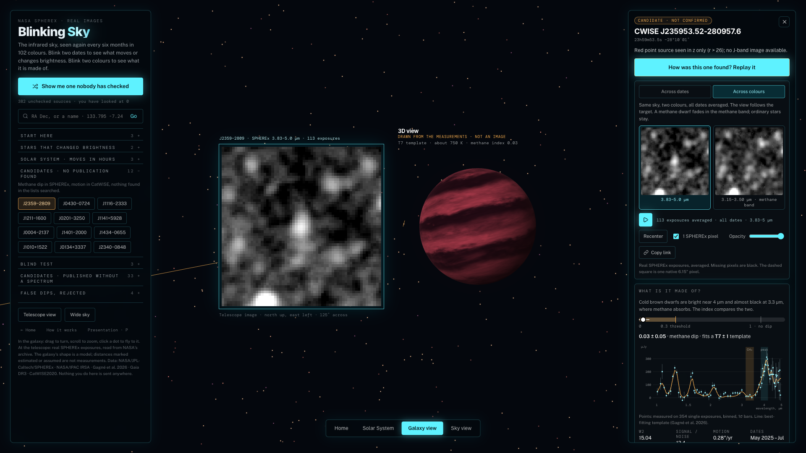
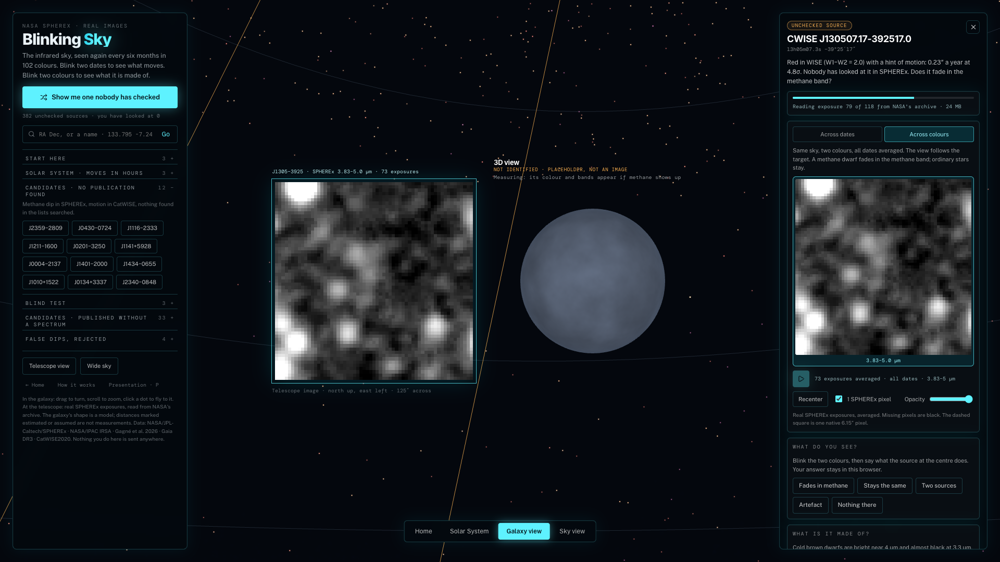
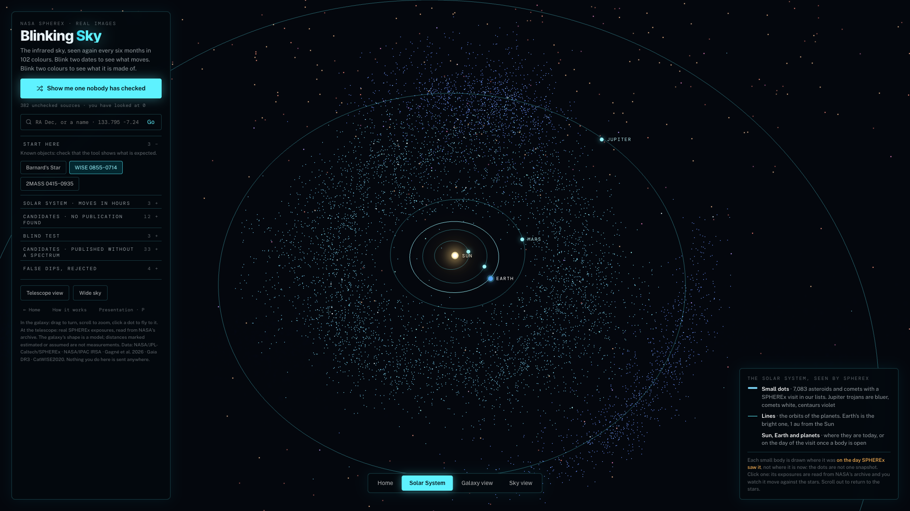
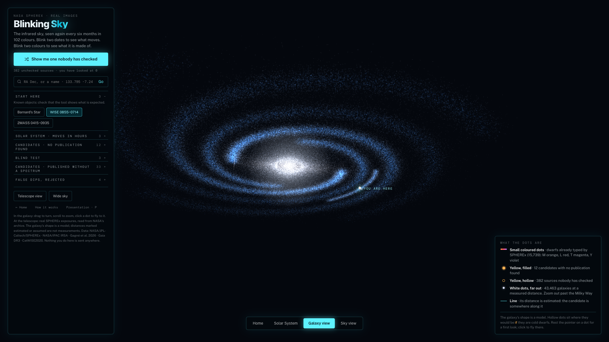
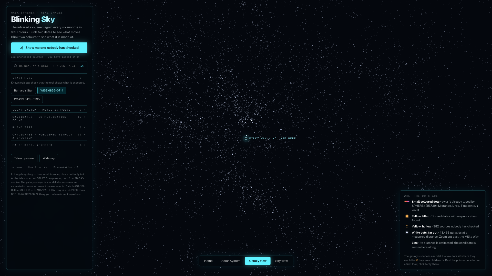
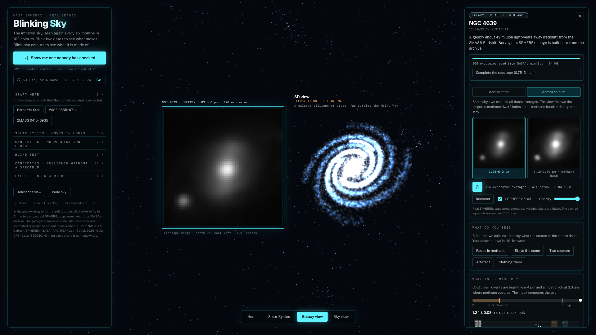

# Space Apps project page — texts to paste

Team: Apollo XXI · Challenge: Planet X and SPHEREx
Text in [brackets] is for the authors to fill in. Every link must be tested in a private browser window before submitting.

---

## Project Name

Blinking Sky

---

## Summary (limit 1,500 characters; 50–200 words suggested)

Blinking Sky is a public web tool that lets anyone watch the sky change in real images from NASA's SPHEREx mission. Pick an object or any position, and the tool blinks it across dates and across colours. An asteroid crosses the frame in hours. A nearby brown dwarf shifts from one six-month pass to the next. A cold atmosphere is bright at 4 µm and almost gone at 3.3 µm, where methane absorbs.

There is nothing to install and no account. For any position, the browser reads small pieces of the public SPHEREx files straight from NASA's archive: about 0.3 MB per exposure instead of a 65 MB file. A 3D map places every object at its real distance, from 7,083 asteroids and comets to 15,739 dwarfs and 43,463 galaxies.

The same blink led to a result. By crossing WISE, which says where to look, with SPHEREx, which says what the object is, we list 12 cold brown dwarf candidates for which we found no publication. They are candidates, not confirmed objects. A queue of 382 more sources that nobody has examined is open for anyone to review.

---

## Project Demonstration (link)

[public link to the 30-second video, or to the 7-slide deck]

## Project (link)

https://blinking-sky.vercel.app

Source code: https://github.com/Paulhb7/blinking-sky

---

## Project Details

The headings follow the six questions of the form, in order. The images are shown where they go; the files to upload are in `images/`.

**What does it do?**

Blinking Sky lets anyone watch the sky change in real SPHEREx images, on three time scales: hours for the Solar System, months and years for our nearest neighbours, and no change at all for distant galaxies, which is the reference. It has three parts.

1. A blink viewer. For any position, the visitor blinks between dates to see what moves, and between two colours (3.83–5.0 µm and the methane band at 3.15–3.50 µm) to see what the object is made of.
2. A map with real distances: the Sun, the Earth, the planets and 7,083 asteroids and comets placed where they were on the day SPHEREx saw them; 15,739 ultracool dwarfs already typed by SPHEREx; 43,463 galaxies. Clicking any dot opens its real images.
3. A review queue of 382 red, moving WISE sources that nobody has examined in SPHEREx. The visitor looks at one, says what they see, then sees the measurement.

Try it in one minute at https://blinking-sky.vercel.app (“Open the sky”):

- Type “Ceres” in the search box: six real exposures a few hours apart. The stars stay, Ceres moves.
- Open “WISE 0855−0714” and blink “Across dates”: the coldest known brown dwarf, 7 light-years away, shifts between May 2025 and May 2026.
- Open a source under “Candidates · no publication found” and blink “Across colours”: it is there at 4 µm and gone in the methane band.

*Ceres, read live: the stars stay, the asteroid moves*

*WISE 0855−0714 across three dates*

**How does it work?**

SPHEREx level-2 images are public in a cloud archive that accepts partial requests from a web page. For each exposure the browser asks for three small pieces: the header with the astrometric solution, the wavelength table, and the few image rows that contain the position. That is about 0.3 MB instead of a 65 MB file. An index of the 1.6 million images, cut into small sky tiles, tells the browser which exposures cover a position. Each window has its background removed and is put on one fixed, north-up grid; windows of the same pass (about six months apart) are averaged after rejecting single-exposure outliers. Nothing is moved or amplified, and missing pixels stay black.

To say what an object is, we use one simple test, the methane index: the flux at 3.15–3.50 µm divided by the flux at 3.83–4.20 µm. Below 0.30, with a signal-to-noise ratio of at least 5, we call it a methane dip. On controls, 19 of 21 confirmed cold dwarfs show the dip (the two others have a background star in the pixel), and none of 256 negative controls does. We checked the in-browser reader against a reference analysis in Python: pixel positions agree to a millionth of a pixel.

**What benefits does it have?**

- Anyone can look at real SPHEREx images within seconds, on any position, with no account and nothing to install.
- It gives a result. Applied to red, moving sources from CatWISE2020, the methane test leaves 48 sources consistent with a late T or Y dwarf. Three were already typed from a spectrum: the selection found them blindly, which checks the method. For 33 published candidates, SPHEREx adds spectral evidence. For 12, we found no publication. All are candidates; none is confirmed by spectroscopy, and some of the 12 may already be known to other teams.
- The candidate table gives observers a short list for follow-up spectroscopy. [It is being deposited on Zenodo: add the link, or remove this sentence.]
- The site is static and reads NASA's archive directly, so it costs nothing to keep online.

*The twelve candidates, each at 4 µm and in the methane band*

The twelve candidates, from the clearest to the most fragile (methane index below 0.30 means a dip):

1. CWISE J235953.52−280957.6 · T7 ± 1 · W2 15.05 · S/N 12.4 · index 0.03 ± 0.05
2. CWISE J043050.49−072453.9 · T7 ± 1 · W2 15.52 · S/N 10.3 · index 0.09 ± 0.07
3. CWISE J111646.88−233305.8 · T7 ± 1 · W2 15.34 · S/N 10.1 · index 0.05 ± 0.07
4. CWISE J121122.23−160045.9 · T7 ± 1 · W2 15.30 · S/N 8.2 · index 0.03 ± 0.09
5. CWISE J143401.92−065526.3 · T8 ± 1 · W2 15.78 · S/N 7.6 · index 0.09 ± 0.13
6. CWISE J020114.67−325005.1 · T7 ± 1 · W2 15.64 · S/N 7.1 · index 0.11 ± 0.08
7. CWISE J114142.55+592837.2 · T7 ± 1 · W2 15.53 · S/N 6.9 · index 0.06 ± 0.12
8. CWISE J101027.39+152220.6 · T7 ± 1 · W2 15.51 · S/N 6.9 · index 0.03 ± 0.14
9. CWISE J000415.20−213707.8 · T7 ± 1 · W2 15.53 · S/N 6.6 · index −0.03 ± 0.10
10. CWISE J140138.51−200050.1 · T8 ± 1 · W2 15.80 · S/N 6.4 · index −0.03 ± 0.12
11. CWISE J013425.70+333752.4 · T7 ± 1 · W2 15.57 · S/N 5.7 · index 0.01 ± 0.17
12. CWISE J234020.49−084813.3 · T7 ± 1 · W2 15.65 · S/N 5.0 · index 0.02 ± 0.16

Numbers 8 and 11 have a faint neighbour inside the SPHEREx pixel, and number 12 is at the detection limit.

*A candidate in the methane band, with its SPHEREx spectrum*

**What is the intended impact?**

SPHEREx re-observes the whole sky every six months, and nobody can look at more than a billion sources alone. We want the public to do with SPHEREx what volunteers of Backyard Worlds: Planet 9 did with WISE: blink, notice, report. The review queue is the first step: 382 real sources that nobody has examined, open to anyone. Next, we want to collect the votes so that several people looking at the same source produce a shared answer, ask for spectra of the 12 candidates, and extend the search to the next SPHEREx data release.

*The review queue: a source nobody has examined*

**What tools, coding languages, hardware, or software did you use?**

- Web tool: TypeScript, React, Vite and three.js (WebGL). Static hosting on Vercel.
- Source code: https://github.com/Paulhb7/blinking-sky
- Data preparation: Python with astropy and numpy.
- Data: SPHEREx level-2 images from NASA/IPAC IRSA, CatWISE2020, and the other sources listed below.
- Hardware: two laptops. No server and no paid computing.

The methane analysis, the index of SPHEREx images and the lists of exposures for Solar System bodies were prepared by one team member in the days before the event. The web tool, its in-browser image reader, the maps, the review queue and the texts were made during the 48 hours.

[One or two sentences on the use of AI tools, if the authors choose to state it here as well as in the SI field.]

**How is your project creative?**

- Blinking in colour. The blink comparator is a century old and is used on dates. We also blink two wavelengths, which turns a spectral feature into something anyone can see: the object vanishes.
- No server. Finding the exposures, reading them, aligning and stacking them and measuring the source all happen in the visitor's browser, on NASA's public files.
- One map for everything SPHEREx sees, at real distances, from an asteroid 3 au from the Sun to a galaxy 49 million light-years away.
- Crossing data sets. SPHEREx alone does not say where to look, and WISE alone does not say what an object is. Together they do.

*The Solar System as SPHEREx saw it*

**Three scales in one tool**

The same gesture, click and blink, works at three scales of the Universe.

- The Solar System. The Sun, the Earth and the planets on their orbits, with 7,083 asteroids and comets seen by SPHEREx. Here the sky changes in hours.
- The Milky Way. Our neighbourhood of the galaxy, with the Sun at the origin: 15,739 dwarfs already typed by SPHEREx, the candidates of this work and the 382 unexamined sources. Here the sky changes in months and years.
- The cosmic web. 43,463 galaxies at their measured redshift distance, out to hundreds of millions of light-years, drawing the filaments and voids of the large-scale structure. Here nothing moves, and each galaxy opens on its real SPHEREx image.

The visitor zooms from one scale to the next without leaving the map.

*The Milky Way in the tool, with the Sun marked “You are here”*

*43,463 galaxies around the Milky Way, at their measured distances*

*NGC 4639, a galaxy 49 million light-years away, opened from the map*

**What factors did your team consider?**

- Honest images. The pictures are averages of real exposures. The round bodies drawn next to them are illustrations built from the measurements, and are labelled “not an image”.
- Honest words. Every source is called a candidate. “No publication found” means absent from the catalogues and lists we searched, not “unknown”.
- Privacy. Nothing a visitor does is sent anywhere; votes stay in their browser.
- Access. Each object costs a few megabytes to load, in English, with a guided introduction.
- Limits, stated in the tool. SPHEREx pixels are 6.15″ wide, so only the fastest neighbours move visibly between two passes; for most candidates the evidence is the colour blink and the motion comes from WISE. The test is reliable to W2 ≈ 15.2, works about one time in two down to W2 = 16.0, and does not work in the Galactic plane. Votes are not collected yet.

---

## Use of Super Intelligence (SI)

To select by the authors from the list on the form. The form requires that code written with such tools be acknowledged in descriptive text and metadata.

---

## NASA Data

| Link text | Link URL |
|---|---|
| SPHEREx mission data at NASA/IPAC IRSA | https://irsa.ipac.caltech.edu/Missions/spherex.html |
| SPHEREx public cloud archive (level-2 images) | https://nasa-irsa-spherex.s3.us-east-1.amazonaws.com/ |
| CatWISE2020 catalog (WISE / NEOWISE) at IRSA | https://irsa.ipac.caltech.edu/Missions/catwise.html |
| IRSA Moving Object Search Tool (MOST) | https://irsa.ipac.caltech.edu/applications/MOST/ |
| JPL Horizons | https://ssd.jpl.nasa.gov/horizons/ |
| Backyard Worlds: Planet 9 (NASA citizen science) | https://www.zooniverse.org/projects/marckuchner/backyard-worlds-planet-9 |

## Space Agency Partner & Other Data

| Link text | Link URL |
|---|---|
| Gaia DR3 (ESA) | https://www.cosmos.esa.int/web/gaia/dr3 |
| SPHEREx ultracool dwarf table, Gagné et al. 2026 | [link to the paper or table] |
| 2MASS Redshift Survey | http://tdc-www.harvard.edu/2mrs/ |
| SIMBAD (CDS, Strasbourg) | https://simbad.cds.unistra.fr/simbad/ |
| VizieR (CDS, Strasbourg) | https://vizier.cds.unistra.fr/ |
| DESI Legacy Imaging Surveys | https://www.legacysurvey.org/ |
| The UltracoolSheet | http://bit.ly/UltracoolSheet |
| SIMPLE archive of brown dwarfs | https://simple-bd-archive.org/ |
| three.js | https://threejs.org/ |
| React | https://react.dev/ |
| Vite | https://vite.dev/ |
| React Bits (interface components) | https://reactbits.dev/ |
| Motion (animation library) | https://motion.dev/ |
| Lucide (icons) | https://lucide.dev/ |
| Astropy | https://www.astropy.org/ |
| Music in the demo video: “Floating Cities” by Kevin MacLeod, CC BY 4.0 | https://incompetech.com/music/royalty-free/music.html |
